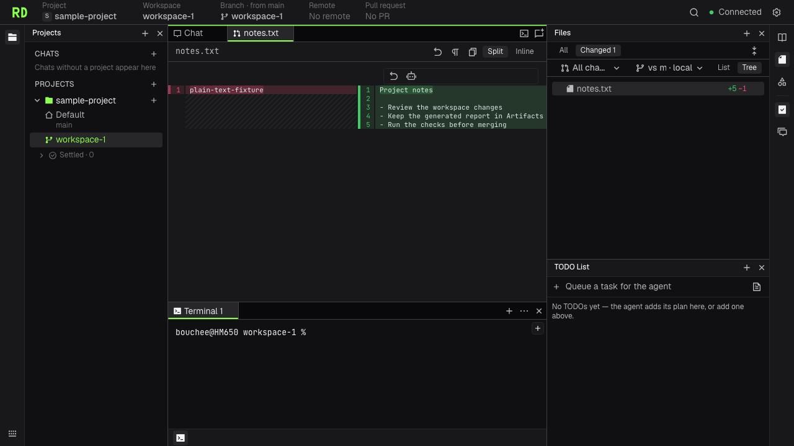

# RailDesign

RailDesign is a fork of ThinkRail's agent workbench with an OpenAI Agents SDK execution kernel.
It keeps the project/worktree navigation, Monaco editor, file tree, Diff, terminal, themes and localization.
Markdown previews include a collapsible heading outline that follows the current section. Choose its
left or right position in Appearance settings.
Reorder open projects by dragging their names, using the project menu, or pressing Alt+Shift+Up/Down.
The order is shared across windows.
Copy and paste files or folders across workspaces from the file tree, or move deleted entries to the
system trash. File-tree menus and file or Diff tabs also offer Copy path.
Chat prose defaults to 80 columns and file views to 120. Wide code, tables, diagrams and tool results
can grow past the prose column within the pane. Saved width choices keep their values.
Images in chat history and tool results load on demand, with a Retry action when unavailable.
Artifacts shows workspace deliverables in Smart, list, or folder tree views with their writing chat and keeps the latest copy after an
external deletion; opening a deleted artifact restores it first. Diagrams and comparisons also save as
Markdown artifacts. Final results also appear with the chat round that produced them. Files and Artifacts share Cut/Paste, rename and move; ignored build outputs are listed without kept copies.
An accent line marks the focused workbench region; keyboard arrivals briefly show a frame.
F6 first highlights the current region, then cycles regions while the frame is visible; Mod+L focuses
the chat input, Mod+0 Projects, Mod+1–9 a center group, and Ctrl+Backquote the terminal. The command
palette offers these actions and desktop zoom controls. Controls that disappear or become disabled
return focus to a nearby control; explicit Show and Jump actions focus their revealed target.
Mod+? opens a filterable keyboard reference with columns that adapt to the window. It is also available from the left rail. Settings → Keyboard edits app, extension and element shortcuts and imports or exports them as JSON.
Tooltips show each button’s shortcut. The reference starts with the surface you were using.
In a review, Tab to the diff, use arrows to pick a line or region, and press Enter to comment.
Press F outside text entry to label clickable controls in Hint mode, or S in a sidebar tree to filter its rows.
Search for a setting in Settings or the command palette to jump to its control.
In Settings, use the arrow keys to move between sections and controls.
From the chat input, Mod+Up enters transcript navigation; arrows or H/J/K/L walk messages and tools,
C copies and O opens a tool’s file. Escape leaves a text field and moves from a side panel back to the main area. History entries offer keyboard menus.
Sidebar trees use arrows, Home/End and type-ahead with one Tab stop per tree. Tab menus, the command
palette and keyboard shortcuts share the same split, move, close and arrangement actions.

The development build connects agent tasks to selected worktrees, with file edits, bounded commands,
streaming output, tool approval and Stop. Sessions save conversation history, input queues and pending
approvals or questions. Steering reaches the next eligible model call; follow-ups wait for normal task
completion. Pending input stays visible until admission succeeds.

Ordinary chats in a trusted worktree can interpret a design brief and hold a review before saving a
requirements baseline. Install the complete `requirements-workflow-host` (3.0.3 or later) and
`json-exporter` Skill directories in RailDesign's application `skills/` directory (`~/.raildesign/skills/` by default).
The RailDesign host needs Python 3.11 or later on PATH. Ask the chat to review a brief in the
worktree, check the presented requirements and reply “I confirm the displayed requirements.” to
commit and deliver the JSON baseline. Reopen the same chat to continue its review, or open another chat for a separate requirements task.

The per-chat Sandbox toggle uses the SDK's Unix-local session to read the selected worktree, with
the same approved file edits. It runs bare `pwd` directly and asks for approval before removing one
regular worktree file with `rm -- <relative-file>`. Other shell commands are rejected. Unix-local
requires macOS or Linux and trusted Python 3. Shell commands run with host permissions.

Turn on Retained memory in a Sandbox chat without a Handoff graph. The selected model saves SDK
memory after a successful run. The next run can read the saved memory, including after a host
restart. The chat owns its memory archive, and project files stay in the Git worktree.

Restart restores saved conversations and pending interactions. Interrupted side effects are marked
unknown and require a new user decision. `/compact` summarizes model memory while retaining the full
conversation for display and search. Automatic summaries use the selected verified model's context
budget. Models settings offers Earlier / Default / Later summary timing based on estimated history
length; summary failures preserve the previous memory. Pending runs from before workspace identity
checkpoints must be finished or explicitly stopped before updating; completed conversations stay readable.

The SDK tool graph includes admitted Skills and workspace instructions, questions, visualization,
Plan and Spec Graph, configured MCP tools, and foreground or background child tasks. Resources retains
child transcripts and background-command output, with ownership checks and Stop controls. The Resources
dock can fold while work continues; inspect an MCP server for its status and this chat's calls.
Open workspace HTML in your browser from its preview, tab, or Files menu. Browser workbench
mockup previews can run inline behavior in an isolated frame without network access. Desktop previews
show the static version.
Use F6 to reach a waiting question. Answer it with the keyboard, or compare its option previews
individually, side by side or in a grid. Choosing an option closes the preview and returns to the question.
Plan review uses an independent SDK child with a validated verdict saved in its read-only transcript.
Plan and Review show the recorded outcome and findings. Finish or stop pending reviews before updating;
older pending review checkpoints stop explicitly.
An optional `handoffs.json` (personal, or in a trusted project's `.raildesign/`) declares which agent
definitions may take over a chat through SDK Handoffs. The chat shows each transfer, who handles the
conversation and who wrote each reply; the accepted agent answers later messages after refresh and restart.
A `without_tools` target sees the conversation without earlier tool records. Provider acceptance of a
live transfer is a separate gate.
Guardrails keep configured credentials and token-shaped values away from the model: a tool result that
contains one is withheld from the model (the run continues and the tool row says so), and a tool call
that contains a configured key is rejected before approval. Assistant replies are checked by the host
before they are shown or saved: a reply with a configured key or token stops the run and is never shown,
saved or sent back to the model (live text can trail by a few characters). An optional `guardrails.json`
(personal, or in a trusted project's `.raildesign/`) adds rules for user input, tool input and tool output
(literal or regex) and assistant output (literal only); a malformed file stops the run with an explicit
error.
Web search and page reading use DeepSeek Search and Fetch with a separate
host key configured in Extensions settings. Skill search, content reads, manual `/skill:name` commands
and idle catalog reload share current trust and enable policy. The Extensions settings page manages bundled SDK
extensions and their declared settings; Pi package installation and Pi built-in switches are retired.

Agents can start independent workspace tasks and inspect their status. A chat without a project can
continue in a repository workspace with a summary and a link back to its source. Adding a TODO by hand
notifies its agent through the session queue and respects pending questions and approvals. Configured
MCP servers also expose resource lists, resource templates and resource reads through the SDK tools.

Subagents settings lists the available built-in and personal roles, plus definitions in the active
trusted workspace. Turn a role off by name to prevent new and queued invocations across projects.
Already running children finish.

Desktop releases and private-server deployment have separate acceptance stages. This source checkout
does not establish a released installer or cross-platform acceptance.



## Develop locally

Use the Bun version pinned in `package.json` and Git on the host.

```bash
git clone https://github.com/Bouchee/raildesign.git
cd raildesign
bun install
bun run dev
```

Configure a verified Responses-compatible endpoint and its model in the app's Custom endpoints settings,
or provide `OPENAI_BASE_URL`, `OPENAI_MODEL` and `OPENAI_API_KEY` to the host. The base URL ends before
`/responses`. The stage 0 verified target is OpenCode Go:

```text
OPENAI_BASE_URL=https://opencode.ai/inference/go/openai/v1
OPENAI_MODEL=deepseek-v4.1-flash
```

Keep the API key in protected host configuration. Do not commit it or include it in browser assets.
Listing a model through `/models` does not prove Responses or tool support.

The CLI is `raildesign`; `--no-open` starts the same host without opening a browser.
CLI and desktop entries share one execution path. The host, its Git commands and agent tools act on the
same selected worktree; the displayed Diff comes from the actual files.

On macOS, desktop file links use `raildesign://open?file=%2Fpath%2Fto%2Ffile.ts&line=12&column=3`.
Encode the absolute file path in `file`; it must belong to an open project or workspace. Line and
column numbers start at one.

## Identity and local data

RailDesign's application identifier is `io.github.bouchee.raildesign`. Its default state directory is
`~/.raildesign`; CLI installation metadata and cache use `raildesign` directories. It starts with fresh
records and does not import official ThinkRail or pi sessions, credentials or plugins.
Sessions use format 2. Earlier-format files remain on disk and are not migrated.

Updates are configured only for [this fork's releases](https://github.com/Bouchee/raildesign/releases),
with the desktop channel under `releases/download/desktop-updates`. Signing, installation and an actual
update between releases remain separate release gates.

JetBrains service integrations, telemetry, attribution and surveys are removed. Local SDK tracing starts
disabled and can be enabled in chat settings. Traces are not exported to OpenAI. Existing font family
names and upstream license notices remain as required.

## Verify

Run focused tests while developing. Before handing off app changes, run the repository dependency,
boundary, lint and typecheck gates and the complete no-agent browser suite once. Changed agent behavior
also needs an isolated focused live check. The full live suite requires explicit approval.

```bash
bun run check:deps
bun run check:boundaries
bun run lint
bun run typecheck
bun run test
bun run e2e
```

[Product scope](goal-and-requirements.md), [architecture](architecture.md) and each module's `SPEC.md`
define the contracts. Preserve the [upstream license](LICENSE) and attribution notices.
